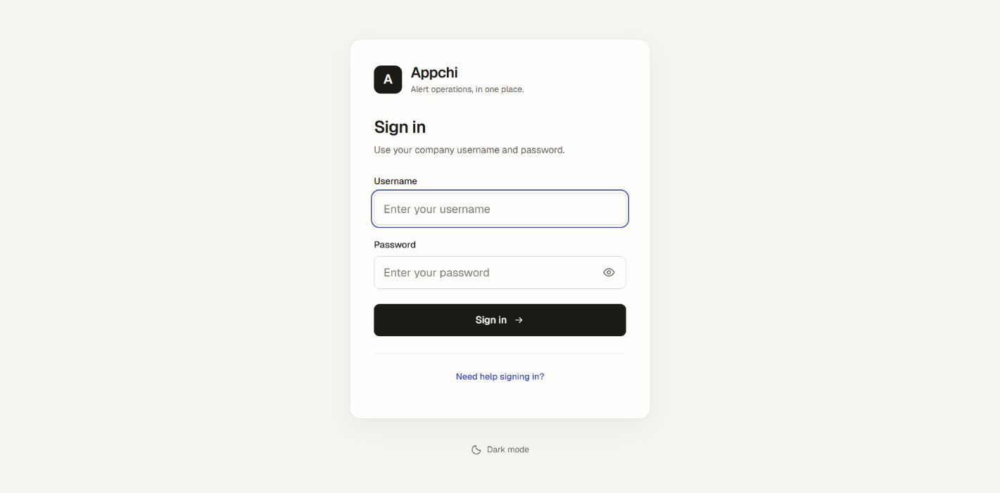
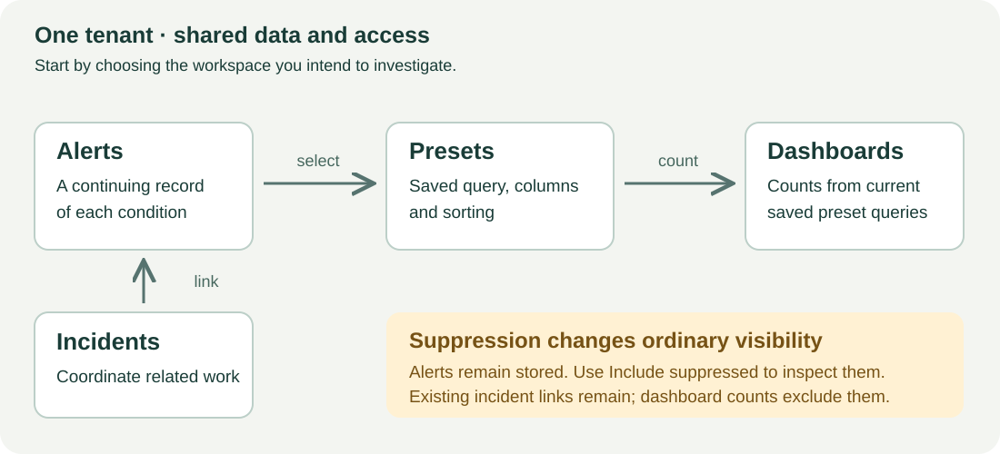

# Getting started

[Guide contents](README.md) · Next: [Feed and search](02-feed-and-search.md)

## Sign in and choose your workspace

1. Open the Keep address supplied by your organization.
2. If Keep shows its landing page, choose **Sign in with company account**. On the sign-in form, enter your company username and password and select **Sign in**. An existing company sign-in session may take you straight into Keep.
3. Check the tenant selector beside the breadcrumb. Choose the team or service workspace you intend to work in.
4. Check the access label. **View access** lets you investigate; **Edit access** also lets you change operational records and shared configuration.

Keep opens your last accessible tenant, otherwise **Global**. A tenant is a boundary for data and permissions, not a search filter across the whole company. The same search in two tenants can produce different results. Presets, dashboards, incidents and alert links stay within their tenant.

*The company sign-in form. Use your organization's supplied account, not the names shown in guide examples.*

Global is the shared tenant for legacy alerts; eligible signed-in company users have Edit access there. Other tenants have their own access grants. If an expected tenant is missing, ask the team that manages Keep access. Being assigned an alert does not grant access to its tenant.

Use your company's normal password reset or account unlock process if you cannot sign in. Keep does not give you a separate company password. A stale sign-in attempt should be restarted from the page's sign-in control.

## Understand the six main concepts

*A preset selects alerts; a dashboard counts those selections. An incident coordinates work on related alerts. Suppression affects ordinary visibility without deleting an alert.*

| Concept | Meaning in daily work | Use it when |
|---|---|---|
| Alert | One continuing record of a monitored condition. Repeated deliveries update that record. | Investigating a specific problem. |
| Occurrence | A firing episode on an alert. A resolved alert that fires again begins another occurrence on the same record. | Distinguishing today's recurrence from the earlier problem. |
| Assignment | The person currently responsible for an alert or incident. | Taking ownership or handing work to another eligible person. |
| Incident | A shared investigation with its own status, severity, assignment and related alerts. | Several alerts belong to one piece of operational work. |
| Preset | A tenant-shared saved query, columns and sort order. | Repeating a useful search consistently. |
| Dashboard | A tenant-shared arrangement of counts supplied by saved presets. | Watching several operational views at once. |

**Severity**, **status** and **suppression** answer different questions. Severity describes how serious the signal is. Status says whether it is firing, assigned while firing, or resolved. Suppression says whether it is normally excluded from feeds, dashboards and automatic correlation. A critical alert can be acknowledged and suppressed at the same time.

## Read alert status correctly

| Visible status | What it means | Typical next step |
|---|---|---|
| Firing | The alert is firing and has no assignee. | Investigate and assign responsibility. |
| Acknowledged | The alert is firing and has an assignee. | Check the owner and current investigation. |
| Resolved | The alert's lifecycle is resolved, whether or not an assignee remains. | Review recovery and history; watch for a new occurrence. |

There is no separate Acknowledge action. Assigning a firing alert acknowledges responsibility. Unassigning it makes the visible status Firing again without changing the underlying monitored condition. Neither assigning nor resolving a Keep record repairs the affected service.

## Find your way around

The left navigation offers **Feed**, **Incidents**, **Presets**, **Rules**, **Maint.** and **Boards**. Maint. opens maintenance windows; Boards opens dashboards. Administrative areas may also appear depending on your access, but are not needed for the workflows in this guide.

Open an alert by clicking its row. Checkboxes and row action controls act separately. Breadcrumbs return to the parent area; when you opened an alert from a saved preset, use **Back to preset** to keep that context. Ordinary links also support opening a new browser tab.

Use the account control at the bottom of the navigation to change Light/Dark appearance or **Sign out**. Appearance is remembered on the device. Wide tables scroll within their own panel on small screens; a missing offscreen column does not mean the field is empty.

## Know which actions you can take

| Daily activity | View | Edit |
|---|---|---|
| Read alerts, incidents, shared views and available history | Yes | Yes |
| Run an ad hoc Feed search and use temporary filters | Yes | Yes |
| Assign, resolve, edit permitted fields or write notes | No | Yes |
| Create or change incidents and links | No | Yes |
| Save shared presets and dashboards | No | Yes |
| Change correlation rules or maintenance windows | No | Yes |

These permissions do not remove other restrictions, such as a concurrent edit or an ineligible assignee. If you only need to inspect data, changing filters is enough. Do not save a shared view simply to customize your screen for one investigation.

## Keep your session and work safe

Keep sessions expire after 30 minutes without accepted activity, or after 24 hours even with continued activity. A visible dashboard keeps the session active, but a hidden background tab does not. Save useful shared changes before leaving; drafts are held in the current tab and are not reliable storage across a reload or session loss.

Changing tenants clears that tenant's current selection and working context. If you have an unsaved definition, review the leave/discard prompt before switching. Access loss can clear protected content immediately; it does not wait for a draft to be saved.

Keep does not send product notifications in this release. Assignment and notes record coordination inside Keep; use your team's established communication channel when someone needs to be told about a handoff.

## Reference

[System concepts](../../../keep-design/specs/spec-alerts-management-system.md) · [Access](../../../keep-design/specs/spec-tenant-access.md) · [Sign-in](../../../keep-design/specs/spec-identity-configuration.md) · [Current UI](../../../keep-frontend/docs/ui-design.md)

Next: [Feed and search →](02-feed-and-search.md)
