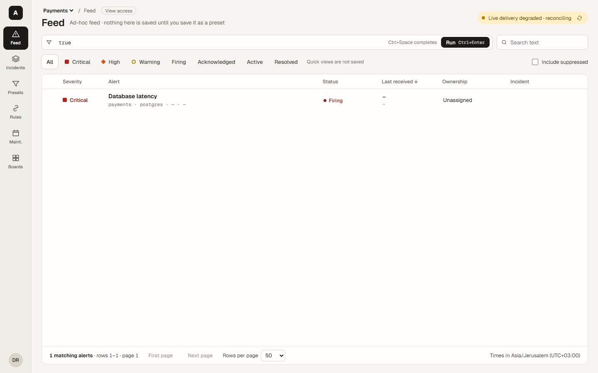

# Feed and search

[Guide contents](README.md) · Previous: [Getting started](01-getting-started.md) · Next: [Working with alerts](03-working-alerts.md)

Use **Feed** to answer a question now: what needs attention, what happened to an application, or where a particular message appeared. For a view you use every shift, open a shared [preset](05-presets-and-dashboards.md).

*Feed with synthetic example data. The illustration explains the controls; it does not show your tenant's alerts.*

## Understand what one row means

One row represents a **logical alert**. Repeated deliveries update that alert rather than creating a row for every message. If it resolves and later fires again, it starts another **occurrence** on the same alert. Consequently, “20 matching alerts” means 20 logical alerts, not 20 deliveries or failures.

An alert's severity expresses urgency: **Critical**, **High** or **Warning**. Status expresses its current working state:

| Status | What it means for your work |
| --- | --- |
| **Firing** | The alert is firing and has no current eligible assignee. Review who should take responsibility. |
| **Acknowledged** | The alert is firing and assigned to a user. Check the assignee and notes before duplicating work. |
| **Resolved** | The alert's lifecycle is resolved. Its history and assignment can still be visible. |

A **Suppressed** badge is separate from status. It means maintenance or the source is suppressing the alert; it does not mean the underlying problem is fixed. See [maintenance and correlation](06-maintenance-and-correlation.md).

Occasionally severity is **Clear** when the first message seen was a legacy resolution and the earlier urgency is unknown. Clear is not another urgency level.

## Start a focused review

1. Check the selected tenant, then open **Feed**.
2. Keep the CEL expression `true` for an unrestricted starting query.
3. Select a quick view. **Active** includes both Firing and Acknowledged; **Firing** shows only unassigned firing alerts. **Resolved** is useful for checking completed work. **All** removes the quick-view restriction, but keeps your other filters.
4. Review severity, message, assignee and receipt time. Open an alert's message link to inspect it before acting.

**Critical**, **High** and **Warning** narrow by severity. Quick views combine with the expression and text search already applied. They do not replace those filters. If you selected Resolved while your expression requires firing, no alerts can match both.

## Search words or filter specific fields

Use **Search text** for words in the message, impact or current undeleted notes. Search is case-insensitive, and all query tokens must match across those fields. It is plain text: entering CEL or a regular expression here will not execute it. It does not search old note revisions or every source field.

Use the **CEL expression** bar for precise field conditions. CEL is a small expression language: each alert either matches the condition or does not. You can start with the examples below without learning the full language.

1. Select **All** to avoid an unintended quick-view restriction.
2. Enter your expression and, optionally, words in **Search text**.
3. Select **Run**. Typing alone does not apply the new query. In the expression editor, **Ctrl+Enter** also runs it.
4. Check the result count and any validation message. An invalid expression is an error, not evidence that no alerts exist.

| Question | CEL expression |
| --- | --- |
| Which alerts belong to the payments application? | `application == "payments"` |
| Which critical or high alerts are still active? | `status == "firing" && severity in ["critical", "high"]` |
| Which firing alerts have an owner? | `display_status == "acknowledged"` |
| Which alerts received source updates in the last hour? | `timestamp >= now() - duration("1h")` |
| Which application names contain this text? | `application.contains("payments")` |
| Which alerts are suppressed? | `suppressed == true` — also enable **Include suppressed** |

Replace `payments` with your application's exact value. CEL string comparisons and string functions are case-sensitive. `&&` means both conditions must match; `||` means either may match. Use parentheses to group alternatives. Quoted values are text; `true` and `false` are boolean values.

Select the funnel button, **Supported fields and functions**, for the available catalog, or press **Ctrl+Space** in the editor for suggestions. Only supported fields and functions work. Use `display_status` for current ownership filters; old expressions using `acknowledged` refer to legacy data and do not mean current assignment.

The last-hour example uses the latest received source update, not the time someone added a note. Relative time is evaluated for the query snapshot; returning to the first page obtains a fresh view.

## Include suppressed alerts when investigating missing results

Ordinary Feed results exclude suppressed alerts. Enable **Include suppressed** to let both suppressed and unsuppressed alerts match your query. To see suppressed alerts only, combine the switch with `suppressed == true` and select **Run**.

The switch is necessary even when your CEL explicitly asks for suppressed alerts. **All** alone does not include them. This setting is temporary and is not stored in a preset; reopening a preset returns to the ordinary exclusion.

Suppressed alerts continue receiving updates and retain history. If a maintenance window has ended, an alert can remain suppressed until its next qualifying source update. Waiting or refreshing alone does not release it.

## Sort, page and interpret updates

The default order puts the latest received source updates first. Click a supported column heading to sort ascending, click again for descending, and a third time to restore the normal order. Sorting starts on page one and clears the selection. Some headings, including the derived Status, do not sort.

Use **Rows per page** for 50, 100 or 200 rows and **Next page** to continue. Later pages preserve a snapshot so arrivals do not move rows during your review. When **New results available** appears, use **Back to first page**. If the snapshot expires, restart from the first page.

Counts describe the current filter and snapshot. **Count unavailable**, an error, or previous results shown during a failed refresh must not be read as zero. The detail page can show your completed action before search catches up; open it to check the current alert. Displayed times use the browser timezone identified on the screen.

## Keep a useful query

**Save as preset…** starts a shared preset with the CEL currently entered in the bar. Review the expression, columns and sorting in that form before saving. Search text, quick views and **Include suppressed** are temporary and are not carried into the saved definition. See [Presets and dashboards](05-presets-and-dashboards.md) for the complete workflow.

If results still seem wrong, check the tenant, applied expression, text search, quick view and suppression switch in that order. Then consult [Troubleshooting and glossary](07-troubleshooting-and-glossary.md).

## Reference

The guide's source documents are [alert operations](../../../appchi-design/specs/spec-alert-operations.md), [search and history semantics](../../../appchi-design/specs/spec-alert-history-technical.md), [current worker scope](../../../appchi-design/specs/spec-worker-scope.md), and [frontend UI design](../../../appchi-frontend/docs/ui-design.md).
