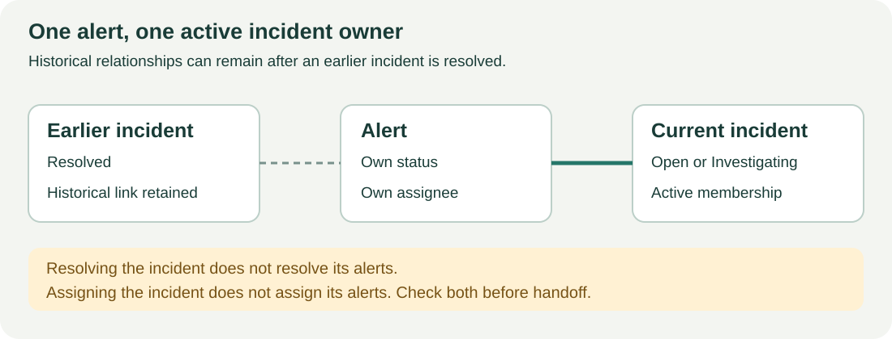

# Incidents

[Guide contents](README.md) · [Previous: Working with alerts](03-working-alerts.md) · [Next: Presets and dashboards](05-presets-and-dashboards.md)

An **incident** brings related alerts, notes and responsibility into one place. Use one for related symptoms or a coordinated investigation. People or correlation rules can create incidents.

Readers can inspect incidents and history. Creating or changing an incident requires **edit access** to the selected tenant. Assignment does not grant access.

## Understand what an incident changes

| Incident information | Meaning |
|---|---|
| **Open** | The incident is active and needs attention. |
| **Investigating** | Investigation is underway; the incident is still active. |
| **Resolved** | The incident investigation has been closed. |
| **Assignee** | The person responsible for the incident. Assignment and status are separate. |
| **Severity** | The severity chosen at creation. It cannot be changed afterward. |
| **Origin** | Manual creation or the correlation rule that created it. Origin does not change. |

An incident's status and its alerts' statuses are independent. Resolving an incident does **not** resolve its alerts. Resolving every linked alert does **not** resolve the incident. Assigning an incident does not assign its alerts, and selecting **Investigating** does not assign the incident to you.

*Concept illustration. Each alert can belong to only one active incident. Historical links to resolved incidents can remain visible.*

## Find the investigation you need

Open **Incidents** in the correct tenant. The default **Active** view shows open and investigating incidents. Use **Resolved** for completed investigations or **All** to include both.

Use **Search** and filter by status, severity, assignee or creation source. **Me** finds your work; **Unassigned** finds work without a responsible person. **More filters** provides identifier and time filters. Filters work together; clear old filters if an incident is missing.

Open an incident to review its description, origin, assignee and linked alerts. The linked-alert section includes resolved and suppressed alerts. Suppressed alerts remain part of the investigation; suppression does not remove their links. An unavailable historical reference means the full alert cannot be opened, not that its current state is known to be resolved or suppressed.

## Create and take responsibility

1. Select **New incident**.
2. Enter a clear **Title**, such as “Checkout failures in the west region.” Add an optional **Description** covering the impact and what is known.
3. Explicitly choose **Critical**, **High**, **Medium** or **Low**. Check this carefully because severity becomes fixed.
4. Select **Create incident**. The current form creates an open, unassigned incident; link alerts from its detail page afterward.
5. Open **Assign…**, then choose **Assign to me** or select an eligible colleague. Use **Unassign** when responsibility should be cleared.
6. Select **Investigating** when work begins. Add your findings under **Notes**.

Titles allow 200 characters and descriptions 10,000. Duplicate titles are allowed; share the incident link for handovers. **Edit title and description** works even on resolved incidents. Text is plain text; Markdown formatting is not interpreted.

## Link the relevant alerts

From an active incident, select **Link alerts…**. Search by text, select the relevant rows, and choose **Link selected alerts**. Turn on **Include suppressed** when a maintenance-related alert belongs in the investigation. The option starts off; linking a suppressed alert does not unsuppress it. You may also link a resolved alert to preserve useful context.

For precise selection, expand **Enter known alert IDs**. Entered IDs replace the checkbox selection. Use unique IDs from the current tenant, with at most **100 alerts per operation**.

An **Other incident** marker indicates an alert already has an active owner. Ordinary linking cannot take it away. A conflict leaves the whole selection unchanged, so review the conflicting owner before retrying.

## Unlink or move an alert

Use **Unlink or move…** when the investigation changes:

| Action | When to use it | How |
|---|---|---|
| **Unlink alerts** | The alert is unrelated and should leave this incident. | Choose the operation, select the alerts, then **Unlink selected alerts**. |
| **Move to another incident** | Another active investigation should own the alert. | Choose the operation, select alerts and a **Destination active incident**, then **Move selected alerts**. |

Both incidents must be active in the same tenant. Alerts transfer together; a conflict changes none. Unlinking or moving preserves history, alert status, suppression and assignment. Empty incidents remain available.

Resolved incidents have fixed membership until reopened. Unlinking also prevents automatic correlation from immediately adding the same alert back using its old evidence; a later qualifying source transition is required for automatic reuse.

## Leave a useful handover

In **Notes**, write what you observed, what you tried, the result and the next action, then select **Add note**. For example:

> Checkout errors began after the west-region release. Compared with the east region; no matching errors there. Rollback requested through the team's usual channel. Next: check recovery after rollback and review the two linked alerts.

Notes may contain up to 10,000 characters and must include nonblank text. Editors can edit or delete any incident note, including on a resolved incident. **Edit note** and **Save note** add a revision. **Delete note** hides the current text while retaining its history. Readers can inspect note revisions and deletion records.

Use **Activity** to understand who changed status, responsibility or membership and when. Use **Cycles** to distinguish the original investigation from later reopenings. Appchi does not send product notifications; use your team's normal communication channel when another person must act.

## Resolve, then reopen only if necessary

When the investigation is complete, add a final note and select **Resolved**. A note is useful but not required. Check the linked alerts separately: they keep their own firing/resolved state. The incident releases its active ownership of those alerts while preserving relationships in history.

To reopen a resolved incident, select **Open** or **Investigating** in its status controls. Reopening starts a new lifecycle cycle and preserves an eligible assignee. It can fail if another active incident now owns a linked alert, or if another active incident occupies the same originating correlation-rule group. Review the blocking incident; Appchi does not silently take ownership away from it.

There is no **Delete incident** action. The current release also has **no automatic inactivity resolution or automatic retention sweep**. Some screens still display inactivity or retention deadlines from an earlier design; do not rely on those labels to close or remove an incident. Explicitly resolve finished work.

If someone changes an incident while you are editing it, review the new state before retrying. In a membership dialog, **Clear selection and reload revision** resets your selection to the refreshed incident version. If the outcome is uncertain after a connection failure, use **Retry original command** so the original action is checked safely rather than starting a duplicate action.

## Example: one problem, several symptoms

Three alerts describe checkout errors, payment timeouts and queue growth. Open one incident, choose severity, assign responsibility and link the three alerts. During investigation, you discover the queue alert belongs to a different ongoing problem: move it to that active incident. Record the diagnosis and mitigation in notes. After recovery, verify the remaining alerts and resolve the incident explicitly. If the problem returns, inspect current ownership before reopening or starting a new investigation.

## Reference

This chapter follows [incident operations](../../../appchi-design/specs/spec-incident-operations.md), [correlation rules](../../../appchi-design/specs/spec-correlation-rules.md) and the superseding [current worker scope](../../../appchi-design/specs/spec-worker-scope.md).

[Guide contents](README.md) · [Next: Presets and dashboards](05-presets-and-dashboards.md)
