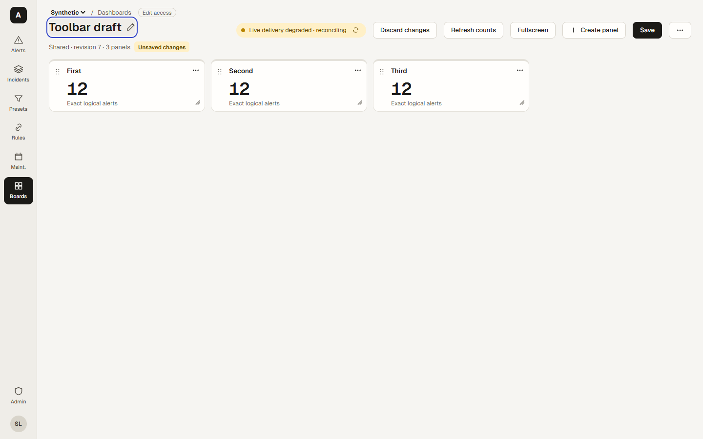

# Presets and dashboards

[Guide contents](README.md) · Previous: [Incidents](04-incidents.md) · Next: [Maintenance and correlation](06-maintenance-and-correlation.md)

## Choose a reusable view

Use a **preset** when you want a repeatable list of alerts, with useful columns and ordering. Use a **dashboard** when you want to monitor several preset counts together and open the underlying lists as needed. Both are shared with the tenant. There are no private saved presets or dashboards.

*Temporary choices affect your current view. Saving a preset changes the definition used by everyone and by every dashboard panel that references it.*

For example, a team could save a preset for its active payment alerts, another for critical alerts and another for recent recoveries. A dashboard can show their counts side by side. These groups can overlap: adding their counts together does not necessarily give the number of distinct alerts across all three.

## Open and explore a preset

1. Open **Presets** and search by name if necessary.
2. Click the preset's row. Check its filter summary, which shows the saved expression, any saved grouping and the sort, and its columns.
3. Use **Search text**, a quick view or **Include suppressed** for the immediate investigation. Press the selected quick view again to return to **All**.
4. Click a supported sortable column heading to sort ascending; click again for descending; click a third time to restore the saved order.
5. To see the results grouped another way, choose a field in **Group by**. The menu tags the preset's saved field **Saved**. Select **Reset** to return to the saved grouping.
6. Open an alert row. Use **Back to preset** to return to its results.

Temporary text search, quick views, suppression inclusion, column-heading sorting and a **Group by** change in the results toolbar do not edit the shared preset. Reopening a preset starts from its saved definition, with text search empty, suppressed alerts excluded and the saved grouping. A new saved revision also clears a temporary sort or grouping. Grouped results work as described in [Feed and search](02-feed-and-search.md#group-results-by-one-field). Status is a derived display field and does not offer ordinary Status sorting; **Lifecycle** sorts the underlying firing/resolved state when selected in an editor.

The result count covers all matching logical alerts, not just the loaded page. The query `true` includes retained resolved alerts as well as firing alerts, subject to suppression exclusion. A preset is not automatically an active-alert view: read its actual filter.

## Create a preset with Edit access

Use this when a search is useful to the whole tenant, for example as a standard shift view.

1. Open **Presets → New preset**, or start from the Feed's **Save as preset** action.
2. Enter a clear unique **Name**, such as `Payments active alerts`.
3. Enter **Filter (CEL)**. For this example, use `application == "payments" && status == "firing"`, replacing `payments` with the actual application value. See [Feed and search](02-feed-and-search.md) for the difference between raw lifecycle and visible status.
4. Use **Validate CEL** for expression diagnostics and **Preview draft** to inspect matching current alerts. Ctrl+Enter also previews the expression.
5. Under **Columns**, add the fields readers need and use the up/down controls to order them. Keep at least one column; up to 30 distinct supported columns are allowed.
6. Under **Sort**, select one to three supported fields and their directions. A sort field need not be displayed as a column.
7. Optionally, under **Group by**, choose a field so the results show one table per value, such as **Application**. Keep **No grouping** for a single table. Rows inside each group follow the sort above.
8. Select **Create preset**. Reopen it and check that the saved filter, columns, order and grouping express the intended shared view.

The saved definition contains only the name, CEL expression, sort, columns and optional grouping. It does **not** save quick views, Search text, Include suppressed, a **Group by** change made in the results toolbar, collapsed groups, a page position or a separate time range. Put a condition into CEL if it must be part of the shared query. There is no separate time picker; supported time conditions also belong in CEL.

Previewing reads current data; it does not save, change alerts, trigger a rule or simulate historical states. A valid query that matches nothing can still be saved. If you change the expression after previewing, use **Preview draft** again before interpreting the displayed results as matches for the new text.

## Change a shared preset carefully

1. Open the preset. Before editing its query, inspect **Dashboard references** from the preset's options to understand which shared panels will be affected.
2. Select **Edit preset**.
3. Change the name, expression, columns, sorting or grouping and inspect the draft preview.
4. Select **Save changes** to update the existing shared preset, or **Save as new…** and supply a unique name to create a second shared preset.

Changing the saved query changes every referencing dashboard's future counts. Changing only columns, sorting or grouping does not change which alerts those panels count. To change a preset's saved grouping, edit the preset; the **Group by** menu on its results changes only your current view. A rename keeps existing links because the preset's identity stays the same.

Use **Discard** to abandon a preset definition draft. If someone else saves first, Keep retains your draft and reports a conflict. Review the newer definition before deciding what to keep. **Save as new…** creates another shared view; it is not a personal copy or an overwrite shortcut.

**History** shows retained changes. Where **Use this revision** is available, it loads an old definition into a draft; an explicit save creates a new revision after current validation. It does not erase intervening history. Deleted presets have retained history but no undelete action.

Deletion affects everyone. A preset that a current dashboard uses cannot be deleted: inspect **Dashboard references**, then have an editor remove or replace those panel references first. Deleting a preset never deletes its alerts.

## Read a dashboard

1. Open **Boards**, then choose a dashboard.
2. Read each panel's title, exact count and any stale or unavailable marker.
3. Select a panel to open the referenced preset's current results, grouped if the preset saves a grouping.
4. Use **Refresh counts** if you need an explicit refresh, or **Fullscreen** for monitoring. Exit fullscreen to return to normal navigation and editing controls.

*Example of an editor's dashboard with unsaved changes. The three counts are synthetic. This screenshot predates the Alerts-to-Feed sidebar rename, the current colours and the removal of the subtitle line with the revision number; the **Unsaved changes** chip now sits beside the dashboard name. The dashboard controls shown remain current.*

Each panel counts logical alert records matching its preset's **current saved query**. It does not count incoming messages, occurrences, incident links or notes. Dashboard counts exclude suppressed alerts and include resolved alerts unless the query excludes them. Dashboards have no Include suppressed switch; use the Feed or preset results to inspect those alerts.

A panel opens a fresh result view. New arrivals, changed alerts, a time-dependent query or a saved preset edit can make its result count differ from the number you just saw. Browser Back returns to the dashboard and refreshes it; it does not replay an earlier snapshot.

**Zero** means a successful query matched no alerts. **Unavailable** means the count could not be obtained. A **stale** number is a previous result and should not be treated as current. Automatic refresh keeps the last useful display while working; a failed query is never evidence of zero problems.

## Create or edit a dashboard with Edit access

1. Make sure the saved presets you need already exist in the same tenant.
2. Open **Boards → New dashboard**, or open an existing dashboard.
3. Click the dashboard name or its pen icon to rename it.
4. Select **Create panel** and choose a **Panel type**. An **Alert count** panel counts a **Saved preset**, with an optional **Custom title** (blank uses the preset's name) and **Count thresholds**. An **Alert table** panel lists the latest alerts of a **Saved preset**: choose the preset, an optional **Custom title** and how many **Alerts to show** (1 to 50). An **HTML** panel shows your own notes, links and tables: give it an optional **Title** and write its **HTML**. An **Image** panel shows a picture such as a diagram or screenshot: choose **Upload a file** or **Link to an image**, add an optional **Title** and **Image description**, and pick a **Fit**. A **ServiceNow tickets** panel shows how many ServiceNow incidents a team has: enter the **Team**, choose the **Ticket state** and **Detection method**, and add an optional **Title** and **Count thresholds**. The preview on the right shows the panel at its size.
5. Select **Create panel** in the dialog. This changes only your draft. A panel keeps its type; to show something else, create a new panel.
6. Repeat for the required panels, up to 24. Use each panel's options for **Edit panel** or **Delete panel**. To edit a panel quickly, point at it and press **E**.
7. Arrange panels using the move grip and resize handle; arrow keys also work on either handle. Panels settle upward to close empty gaps. On narrow screens the dashboard shows the saved layout and panels cannot be rearranged.
8. Select **Save** to save the entire shared name, panel configuration and layout together.

There is no separate dashboard editor. **Apply changes** in a panel dialog updates the draft; it does not replace the dashboard-level Save. A new or changed preset reference says **Save the dashboard to count this panel** until saved. Canceling a panel dialog leaves the existing draft unchanged.

The **Unsaved changes** chip identifies a changed draft. Save is disabled when there is nothing new to save. **Discard changes** asks for confirmation, then restores the current saved definition. Fullscreen hides editing controls, and automatic updates continue; there is no Pause updates control.

## Alert table panels

An alert table panel shows the newest alerts matching its preset's current saved query, newest first by last received, whatever the preset's own sort or grouping. It uses the preset's saved columns; when the panel is too narrow, columns are hidden from the right and **Alert** always stays. Rows that do not fit scroll inside the panel. Select an alert to open it, or the title or **Open preset** to open the preset's full results. The footer shows how many of the matching alerts are listed. Like counts, the table excludes suppressed alerts and refreshes with the dashboard. A preset used by an alert table panel cannot be deleted until the panel is removed or changed.

## HTML panels

HTML panels show text, headings (`h3`–`h6`), lists, tables, links and inline colors, font sizes, spacing and borders. Scripts, images, iframes, forms, event handlers and other styles are removed when you save, and the dialog lists anything that will be removed before you apply it. Links open in a new tab. Content is limited to 16,000 characters after removal. HTML panels never count alerts and never reference a preset.

## Image panels

An image panel shows an uploaded PNG, JPEG, GIF or WebP file of up to 5 MB and 8,000 pixels on each side, or an image at an `https` address. Uploaded files are stored with the dashboard, so everyone who can open the dashboard can see them; each tenant can store up to 500 MB of images. A linked image loads from its own site each time the dashboard opens, so it changes when the source changes, and every viewer needs access to that site. **Show whole image** keeps the full picture with space around it; **Fill the panel** covers the panel and crops the edges. Without a title the image fills the whole panel. When an image cannot load, the panel says **Image unavailable**, with **Open link** for a linked image. Give each image a description so screen readers can read it. Image panels never count alerts and never reference a preset.

## ServiceNow tickets panels

A ServiceNow tickets panel shows how many ServiceNow incidents (INCs) a team has right now, so you can see each team's ticket load without opening ServiceNow. The number comes from the company's ticket counting service, not from Keep alerts or incidents, and the panel never changes tickets. Under the title, the panel shows what it counts, for example **NOC · Open · Hamal**. **Ticket state** counts **Open** tickets, tickets **In progress**, or **Both**. **Detection method** counts incidents the monitoring center raised (**Hamal**), incidents reported straight to the team (**Direct**), or **All**. The top bar takes the color of the highest threshold the count reaches.

Counts refresh about every minute, when you select **Refresh counts** and when you return to the browser tab; a count can be up to about a minute and a half old. When the team name is not known to ServiceNow, the panel says **Team not found**; check the spelling in **Edit panel**. When the counting service does not answer, the panel keeps its last count in grey, with no color and the time it was counted, and retries. When the service is not set up, the type cannot be chosen and existing panels say **ServiceNow isn't connected**. The service is set up in deployment configuration; super admins can check it on **Admin › Integrations**.

## Panel links

Any panel can have a link button, for example to a runbook, a Grafana dashboard or a wiki page. In the panel dialog, fill in **Panel link**: a **Link** that starts with `https://` or `http://`, and optional **Button text** (blank shows **Open link**, up to 40 characters). The preview shows the button at once. On the dashboard the button sits at the end of the title row; on an untitled image it sits in the top-right corner. It opens the address in a new tab, and hovering it shows where it goes. In a narrow panel only its icon shows. Select **Remove link** to take it away. Everyone who can open the dashboard sees the button, but they still need access to the linked site.

## Use color thresholds as a visual aid

Thresholds compare the count to lower bounds. For example, set `1` to amber and `10` to red: zero remains neutral, 1–9 is amber and 10 or more is red. Up to three distinct increasing nonnegative whole-number bounds are supported. The largest bound reached determines the color.

Each threshold has a color button. **Colors** offers eight hues in five shades, from lightest to darkest; these follow the light or dark theme. **Custom** lets you choose any color with the color area and hue slider, or type a hex value such as `#E0569B`; a custom color looks the same in both themes. The preview in the panel dialog shows your choice at once, and the dashboard keeps it when you save.

A red panel is not necessarily a critical alert. Threshold colors are presentation only: they do not change severity, create incidents, notify anyone or take action. Read the preset and threshold meaning before drawing operational conclusions.

## Share, reuse and review

You can share a normal Keep link with a colleague who already has access to the tenant; the link does not grant permission or expose a public dashboard. Dashboard options provide **History**, **Save as new…** and eligible deletion. Copies keep references to the same saved presets, so later query changes affect both dashboards.

Deleting a dashboard removes that shared view and its current panel references, not the presets or alerts. Deleted history is read-only; there is no undelete. Retained configuration history has access limits, so it is not a permanent archive.

## Reference

[Presets](../../../keep-design/specs/spec-preset-operations.md) · [Dashboards](../../../keep-design/specs/spec-dashboard-operations.md) · [Current UI corrections](../../../keep-frontend/docs/ui-design.md)

Next: [Maintenance and correlation →](06-maintenance-and-correlation.md)
