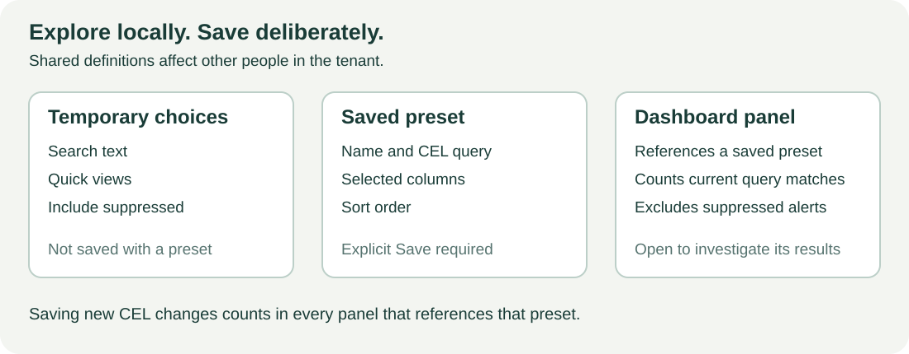

# Presets and dashboards

[Guide contents](README.md) · Previous: [Incidents](04-incidents.md) · Next: [Maintenance and correlation](06-maintenance-and-correlation.md)

## Choose a reusable view

Use a **preset** when you want a repeatable list of alerts, with useful columns and ordering. Use a **dashboard** when you want to monitor several preset counts together and open the underlying lists as needed. Both are shared with the tenant. There are no private saved presets or dashboards.

*Temporary choices affect your current view. Saving a preset changes the definition used by everyone and by every dashboard panel that references it.*

For example, a team could save a preset for its active payment alerts, another for critical alerts and another for recent recoveries. A dashboard can show their counts side by side. These groups can overlap: adding their counts together does not necessarily give the number of distinct alerts across all three.

## Open and explore a preset

1. Open **Presets** and search by name if necessary.
2. Click the preset's row. Check its filter summary, columns and shared revision.
3. Use **Search text**, a quick view or **Include suppressed** for the immediate investigation.
4. Click a supported sortable column heading to sort ascending; click again for descending; click a third time to restore the saved order.
5. Open an alert row. Use **Back to preset** to return to its results.

Temporary text search, quick views, suppression inclusion and column-heading sorting do not edit the shared preset. Reopening a preset starts from its saved definition, with text search empty and suppressed alerts excluded. Status is a derived display field and does not offer ordinary Status sorting; **Lifecycle** sorts the underlying firing/resolved state when selected in an editor.

The result count covers all matching logical alerts, not just the loaded page. The query `true` includes retained resolved alerts as well as firing alerts, subject to suppression exclusion. A preset is not automatically an active-alert view: read its actual filter.

## Create a preset with Edit access

Use this when a search is useful to the whole tenant, for example as a standard shift view.

1. Open **Presets → New preset**, or start from the Feed's **Save as preset** action.
2. Enter a clear unique **Name**, such as `Payments active alerts`.
3. Enter **Filter (CEL)**. For this example, use `application == "payments" && status == "firing"`, replacing `payments` with the actual application value. See [Feed and search](02-feed-and-search.md) for the difference between raw lifecycle and visible status.
4. Use **Validate CEL** for expression diagnostics and **Preview draft** to inspect matching current alerts. Ctrl+Enter also previews the expression.
5. Under **Columns**, add the fields readers need and use the up/down controls to order them. Keep at least one column; up to 30 distinct supported columns are allowed.
6. Under **Sort**, select one to three supported fields and their directions. A sort field need not be displayed as a column.
7. Select **Create preset**. Reopen it and check that the saved filter, columns and order express the intended shared view.

The saved definition contains only the name, CEL expression, sort and columns. It does **not** save quick views, Search text, Include suppressed, a page position or a separate time range. Put a condition into CEL if it must be part of the shared query. There is no separate time picker; supported time conditions also belong in CEL.

Previewing reads current data; it does not save, change alerts, trigger a rule or simulate historical states. A valid query that matches nothing can still be saved. If you change the expression after previewing, use **Preview draft** again before interpreting the displayed results as matches for the new text.

## Change a shared preset carefully

1. Open the preset. Before editing its query, inspect **Dashboard references** from the preset's options to understand which shared panels will be affected.
2. Select **Edit preset**.
3. Change the name, expression, columns or sorting and inspect the draft preview.
4. Select **Save changes** to update the existing shared preset, or **Save as new…** and supply a unique name to create a second shared preset.

Changing the saved query changes every referencing dashboard's future counts. Changing only columns or sorting does not change which alerts those panels count. A rename keeps existing links because the preset's identity stays the same.

Use **Discard** to abandon a preset definition draft. If someone else saves first, Appchi retains your draft and reports a conflict. Review the newer definition before deciding what to keep. **Save as new…** creates another shared view; it is not a personal copy or an overwrite shortcut.

**History** shows retained changes. Where **Use this revision** is available, it loads an old definition into a draft; an explicit save creates a new revision after current validation. It does not erase intervening history. Deleted presets have retained history but no undelete action.

Deletion affects everyone. A preset that a current dashboard uses cannot be deleted: inspect **Dashboard references**, then have an editor remove or replace those panel references first. Deleting a preset never deletes its alerts.

## Read a dashboard

1. Open **Boards**, then choose a dashboard.
2. Read each panel's title, exact count and any stale or unavailable marker.
3. Select a panel to open the referenced preset's current results.
4. Use **Refresh counts** if you need an explicit refresh, or **Fullscreen** for monitoring. Exit fullscreen to return to normal navigation and editing controls.

*Example of an editor's dashboard with unsaved changes. The three counts are synthetic. This screenshot predates the Alerts-to-Feed sidebar rename; the dashboard controls shown remain current.*

Each panel counts logical alert records matching its preset's **current saved query**. It does not count incoming messages, occurrences, incident links or notes. Dashboard counts exclude suppressed alerts and include resolved alerts unless the query excludes them. Dashboards have no Include suppressed switch; use the Feed or preset results to inspect those alerts.

A panel opens a fresh result view. New arrivals, changed alerts, a time-dependent query or a saved preset edit can make its result count differ from the number you just saw. Browser Back returns to the dashboard and refreshes it; it does not replay an earlier snapshot.

**Zero** means a successful query matched no alerts. **Unavailable** means the count could not be obtained. A **stale** number is a previous result and should not be treated as current. Automatic refresh keeps the last useful display while working; a failed query is never evidence of zero problems.

## Create or edit a dashboard with Edit access

1. Make sure the saved presets you need already exist in the same tenant.
2. Open **Boards → New dashboard**, or open an existing dashboard.
3. Click the dashboard name or its pen icon to rename it.
4. Select **Create panel**. Choose a **Saved preset** and, optionally, a **Custom title**. Leaving the title blank uses the preset's name.
5. Choose **Width**, **Height** and any **Count thresholds**, then select **Create panel** in the dialog. This changes only your draft.
6. Repeat for the required panels, up to 24. Use each panel's options for **Edit panel** or **Delete panel**.
7. Arrange panels using the move grip and resize handle. Keyboard controls and the panel options provide alternatives; on narrow screens use the size and Move up/down controls. Panels settle upward to close empty gaps.
8. Select **Save** to save the entire shared name, panel configuration and layout together.

There is no separate dashboard editor. **Apply changes** in a panel dialog updates the draft; it does not replace the dashboard-level Save. A new or changed preset reference says **Save the dashboard to count this panel** until saved. Canceling a panel dialog leaves the existing draft unchanged.

The **Unsaved changes** chip identifies a changed draft. Save is disabled when there is nothing new to save. **Discard changes** asks for confirmation, then restores the current saved definition. Fullscreen hides editing controls, and automatic updates continue; there is no Pause updates control.

## Use color thresholds as a visual aid

Thresholds compare the count to lower bounds. For example, set `1` to amber and `10` to red: zero remains neutral, 1–9 is amber and 10 or more is red. Up to three distinct increasing nonnegative whole-number bounds are supported. The largest bound reached determines the color.

A red panel is not necessarily a critical alert. Threshold colors are presentation only: they do not change severity, create incidents, notify anyone or take action. Read the preset and threshold meaning before drawing operational conclusions.

## Share, reuse and review

You can share a normal Appchi link with a colleague who already has access to the tenant; the link does not grant permission or expose a public dashboard. Dashboard options provide **History**, **Save as new…** and eligible deletion. Copies keep references to the same saved presets, so later query changes affect both dashboards.

Deleting a dashboard removes that shared view and its current panel references, not the presets or alerts. Deleted history is read-only; there is no undelete. Retained configuration history has access limits, so it is not a permanent archive.

## Reference

[Presets](../../../appchi-design/specs/spec-preset-operations.md) · [Dashboards](../../../appchi-design/specs/spec-dashboard-operations.md) · [Current UI corrections](../../../appchi-frontend/docs/ui-design.md)

Next: [Maintenance and correlation →](06-maintenance-and-correlation.md)
