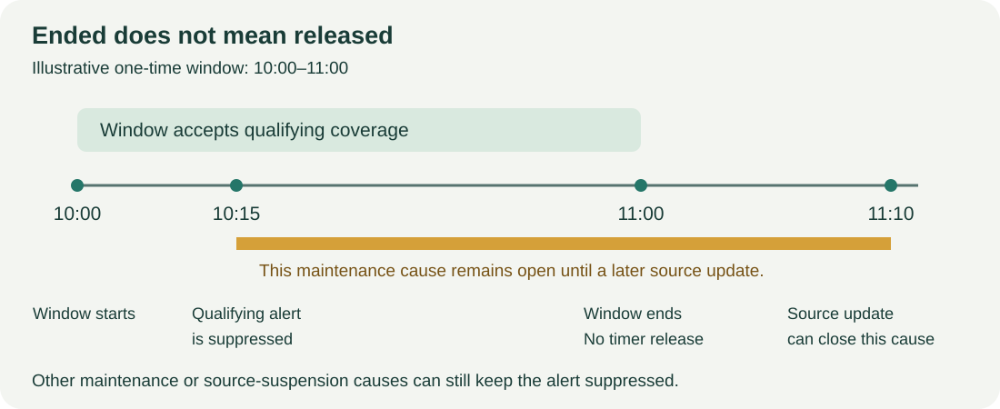

# Maintenance and correlation

[Guide contents](README.md) · [Previous: Presets and dashboards](05-presets-and-dashboards.md) · [Next: Troubleshooting and glossary](07-troubleshooting-and-glossary.md)

Maintenance explains suppression; correlation explains automatic incident grouping. Both are shared within the selected tenant.

Readers can inspect and test definitions. Editing requires **edit access** and responsibility for the shared definition.

## Maintenance: keep expected activity in context

A **maintenance window** is a one-time interval with a condition describing the alerts it covers. Use it for planned work likely to produce expected alerts. Suppressed alerts continue to arrive, retain their history and remain accessible through **Include suppressed** in the Feed. Ordinary Feed results, counts and automatic correlation exclude them by default.

Suppression is separate from lifecycle: an alert may be firing and suppressed, or resolved and suppressed. Existing incident links remain intact. An alert can have multiple maintenance causes plus a separate source-suspension cause; it stays suppressed while any cause remains open.

*Concept illustration. The end of the window stops new coverage. It does not immediately clear existing suppression.*

### Two rules that prevent surprises

**No backfill.** Creating, starting or enabling a window does not scan already-matching alerts and suppress them. Coverage needs a qualifying new alert or transition. A firing alert that matched before the window can remain unsuppressed; an unchanged repeat does not manufacture a new entry transition.

**No automatic timer release.** After a window ends, or is disabled or deleted, an already-suppressed alert can remain suppressed until its next source update received at or after that boundary. An unchanged source repeat can clear this ended cause. Refreshing the page or adding a note does not clear it. Another active cause may still keep the alert suppressed. Ending maintenance never resolves the alert.

For example, a qualifying alert becomes suppressed during a 10:00–11:00 window. At 11:05 the window reads **Ended**, but no later source input has arrived, so suppression remains. A source update received at 11:10 can clear that window's cause. If the source still suspends the alert independently, it remains suppressed.

### Inspect a window

Open **Maintenance**, select the window, and check its reason, **Timezone**, **Starts**, **Ends** and **Which alerts (CEL)** condition. Distinguish its phase from its **Enabled/Disabled** setting. **Ended** describes the schedule; it does not prove that every alert cause has closed.

Review the alerts suppressed by this window and **History** when an alert's treatment is unexpected. A **Blocked** processing state needs investigation; do not assume it means “no suppression.” **Test a current alert** checks a selected alert without changing it. A current match is not proof that the required entry transition happened.

### Create or adjust a window when authorized

1. From **Maintenance**, select **New window**. Enter a name and reason for the planned work.
2. Select the timezone and local start/end times. Use **Validate schedule** and review the converted times. If a daylight-saving transition repeats a local time, select the first or second occurrence; a nonexistent local time must be corrected.
3. Enter the **CEL expression** describing the intended alerts. CEL is the condition language also used by the Feed. Use the field catalog and validation, then test a representative current alert.
4. Select **Create window**. New windows start enabled. Remember that creation does not backfill existing matches.

Use **Edit** and **Save maintenance change** for an existing definition. Once its start has passed, the start time and condition are locked, even if the window was disabled. Before expiry, its end may be adjusted but must remain in the future. An ended window cannot be extended or re-enabled. Changing only the display timezone preserves the actual execution times.

Use **Disable** to stop new coverage without deleting the definition. **Delete** also stops new coverage and requires confirmation; neither action immediately releases existing causes. Recurring schedules are not available.

## Correlation: why Appchi opened an incident

A **correlation rule** looks for fresh evidence that named conditions have been met within a shared time window, optionally grouped by fields such as an application. All conditions need evidence before the rule creates an incident. One alert can satisfy multiple conditions. Once the incident is active, another eligible alert matching any condition can be added.

Eligible alerts must be firing, unsuppressed and available for ownership. An assigned alert displayed as **Acknowledged** can still qualify. An alert already owned by another active incident cannot be taken automatically. When rules compete, earlier-created qualifying rules have precedence; users do not set a priority number.

For example, a rule requires checkout errors and payment timeouts within ten minutes, grouped by application. Fresh evidence for both conditions in the same group can open one incident. Other applications form separate groups. Later eligible evidence matching either condition can add alerts.

### A match is not the same as fresh evidence

Correlation does not repeatedly search all current alerts or replay their full history. Creating or enabling a rule does not backfill old matches. Unchanged repeats do not refresh evidence or restore evidence that expired. Manually changing an alert does not create fresh source evidence.

After resolving an incident or unlinking an alert, old evidence cannot immediately recreate the same automatic ownership. Later qualifying source transitions are required. Suppression, a rule being disabled or deleted, or a condition ceasing to match does not remove existing incident links. Review those links as part of the investigation.

### Inspect or test a rule

Follow an incident's **Created by correlation rule** link, or open **Correlation rules**. Review its conditions, grouping, **Window (minutes)**, enabled setting and health. **Current evidence** explains what is currently supporting it; associated incidents show its results. **History** helps explain a change or reset.

Use the rule's test tool with a current tenant alert. It reports condition matches, grouping and exclusions without creating evidence, incidents or links. A successful test of one alert does not prove all conditions occurred within a real window. If the rule is blocked or delayed, report its name, health and visible diagnostic to the responsible colleague.

### Edit shared rules with care

Authorized editors can select **New rule**, enter a name, explicitly choose incident severity, define 1–10 named conditions, set a window of 1–1,440 whole minutes and optionally select up to three grouping fields. Use **Validate**, test a representative alert, then **Create rule**. The rule starts enabled. Each generated incident starts open and unassigned.

Changing condition logic or the time window resets current evidence. Changing grouping also stops older-group incidents receiving automatic additions under the new grouping. Existing incidents retain their content and links. Disabling stops automatic creation/addition; re-enabling starts fresh evidence collection without backfill. Use these controls for an intentional shared behavior change, not as a way to force a missing incident into existence. For a current investigation, use the manual incident workflow in [Working with incidents](04-incidents.md).

## Reference

This chapter follows [maintenance operations](../../../appchi-design/specs/spec-maintenance-operations.md), [correlation rules](../../../appchi-design/specs/spec-correlation-rules.md), [the Kafka alert pipeline](../../../appchi-design/specs/spec-kafka-alert-pipeline.md) and the superseding [current worker scope](../../../appchi-design/specs/spec-worker-scope.md).

[Guide contents](README.md) · [Next: Troubleshooting and glossary](07-troubleshooting-and-glossary.md)
